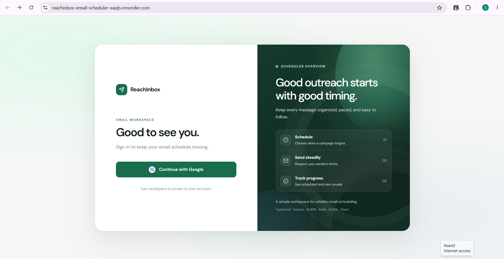
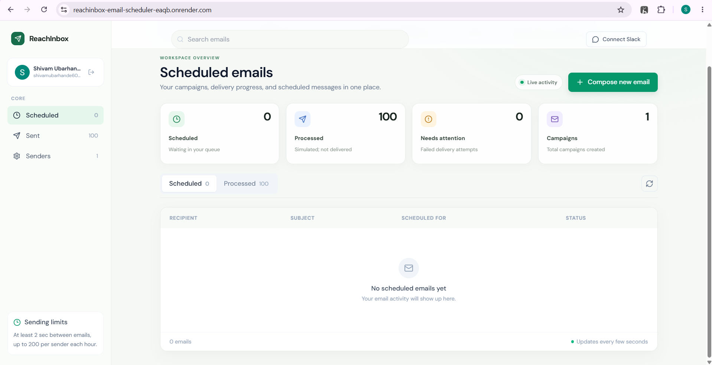

# ReachInbox — Email Scheduler

**A full-stack email scheduling platform built with React, Express, BullMQ, Redis, and MySQL.**

Compose campaigns, schedule background jobs, manage SMTP senders, and track email activity through a unified dashboard. Designed around reliable job processing, sender-level rate limiting, restart recovery, and searchable email records.

[**Live Demo**](https://reachinbox-email-scheduler-eaqb.onrender.com/) · [**Source Code**](https://github.com/shivamubarhande60-cell/reachinbox-email-scheduler)

> **Demo notice:** The hosted demo simulates email delivery because Render's free plan blocks outbound SMTP. No real emails are sent in simulated mode. Real test delivery was verified locally using Ethereal SMTP.

---

## 📸 Application Preview

<p align="left">
  
  
</p>

---

## ✨ Features

| Feature | Description |
|:---|:---|
| **Google OAuth** | Sign in, access a user-specific dashboard, and log out. |
| **Campaign Scheduling** | Compose campaigns, upload recipients using CSV or text, and schedule email delivery. |
| **Background Processing** | Redis-backed BullMQ delayed jobs with queue visibility through Bull Board. |
| **Restart Recovery** | Re-enqueues pending work from MySQL when the application starts. |
| **Idempotency & Retry Safety** | Stable job IDs and idempotency keys help prevent duplicate queue jobs. Uncertain SMTP outcomes are not blindly retried. |
| **Sender Management** | Configure SMTP senders, verify connections, and encrypt saved sender credentials. |
| **Rate Limiting** | Configurable worker concurrency, minimum send spacing, and per-sender hourly limits. |
| **Slack Notifications** | Optional Slack OAuth integration sends direct-message alerts when a sender reaches its hourly cap. |
| **Email Search** | Elasticsearch indexing with a MySQL fallback when Elasticsearch is unavailable. |
| **Queue Dashboard** | Inspect BullMQ background-job status through Bull Board. |

---

## 🛠️ Tech Stack

| Layer | Technologies |
|:---|:---|
| **Frontend** | React, TypeScript, Vite, Framer Motion |
| **Backend** | Node.js, Express |
| **Queue & Jobs** | BullMQ, Redis |
| **Database** | MySQL, Prisma |
| **Search** | Elasticsearch |
| **Authentication** | Google OAuth, session cookies |
| **Email** | SMTP, Ethereal test email service |
| **Integrations** | Slack OAuth |
| **Infrastructure** | Docker, Docker Compose, Render |

---

## 🏗️ Engineering Highlights

### Reliable Background Scheduling

Campaign and recipient records are written to MySQL before delayed BullMQ jobs are added to Redis. On startup, pending database records are checked and re-enqueued, covering interruptions between database writes and queue insertion.

### Idempotency & Delivery Safety

Stable per-recipient job IDs and API idempotency keys help prevent duplicate queue jobs. If an SMTP outcome becomes uncertain after a crash, the application avoids blindly retrying that email because SMTP and the database cannot share one atomic transaction.

### Distributed Sender Throttling

Redis-backed sender locks coordinate sending, while atomic Lua-script reservations enforce hourly limits across workers. Jobs that reach their limits wait for the next UTC hour rather than being discarded.

### Search Isolation

Email indexing runs through a separate BullMQ queue. Elasticsearch indexing failures can be retried independently, so a search outage does not cause an already-sent email to be resent.

### Credential Protection

Dashboard-managed SMTP passwords and saved Slack OAuth tokens are encrypted using AES-256-GCM. SMTP credentials are not returned through the API.

---

## 🚀 Run Locally

### Prerequisites

- Node.js 20 or later
- npm
- Docker and Docker Compose

### 1. Clone the Repository

```bash
git clone https://github.com/shivamubarhande60-cell/reachinbox-email-scheduler.git
cd reachinbox-email-scheduler
```

### 2. Start Supporting Services

Run this command from the project root:

```bash
docker compose up -d
```

This starts Redis, MySQL, and Elasticsearch as defined in the Compose configuration.

### 3. Configure the Backend

Copy `backend/.env.example` to `backend/.env` and configure the required environment variables.

Generate secure secrets using Node.js:

```bash
node -e "console.log(require('crypto').randomBytes(32).toString('hex'))"
```

Run this command separately for `SESSION_SECRET` and `TOKEN_ENCRYPTION_KEY`.

Create an [Ethereal test email account](https://ethereal.email/) and configure its SMTP credentials. Alternatively, connect and verify a sender from the dashboard.

For Google sign-in, create a Google OAuth web client and configure this local callback URL:

```text
http://localhost:5000/auth/google/callback
```

Slack OAuth is optional. To enable notifications, configure a Slack app and use this callback URL:

```text
http://localhost:5000/auth/slack/callback
```

Keep credentials in environment variables. Never commit `.env` files or expose secrets in frontend code.

### 4. Install and Run the Backend

```bash
cd backend
npm install
npm run db:generate
npm run db:push
npm run dev
```

The API and background workers run together at:

- **API:** `http://localhost:5000`
- **Bull Board:** `http://localhost:5000/admin/queues`

### 5. Start the Frontend

Open a second terminal at the project root:

```bash
cd frontend
npm install
npm run dev
```

Open the local URL shown by Vite, normally `http://localhost:5173`.

### 6. Environment Configuration

| Variable | Purpose |
|:---|:---|
| `DATABASE_URL` | MySQL connection string |
| `REDIS_URL` | Hosted Redis connection URL, when used |
| `REDIS_HOST`, `REDIS_PORT` | Redis connection settings when `REDIS_URL` is unset |
| `SESSION_SECRET` | Session-cookie signing secret |
| `SESSION_COOKIE_SAME_SITE` | Cookie policy; `none` requires HTTPS |
| `TOKEN_ENCRYPTION_KEY` | 64-character hexadecimal encryption key |
| `GOOGLE_CLIENT_ID`, `GOOGLE_CLIENT_SECRET` | Google OAuth credentials |
| `GOOGLE_CALLBACK_URL` | Optional Google OAuth callback override |
| `SLACK_CLIENT_ID`, `SLACK_CLIENT_SECRET` | Optional Slack OAuth credentials |
| `SLACK_CALLBACK_URL` | Optional Slack OAuth callback override |
| `SMTP_SENDERS` | JSON array of environment-configured SMTP senders |
| `DEMO_EMAIL_MODE` | Enables simulated delivery; no email is sent |
| `WORKER_CONCURRENCY` | Worker concurrency; default `5` |
| `EMAIL_DELAY_MS` | Minimum send spacing; default `2000` ms |
| `MAX_EMAILS_PER_HOUR_PER_SENDER` | Sender hourly cap; default `200` |
| `ELASTICSEARCH_NODE` | Elasticsearch endpoint |
| `ELASTICSEARCH_API_KEY` | Optional hosted Elasticsearch API key |
| `ELASTICSEARCH_USERNAME`, `ELASTICSEARCH_PASSWORD` | Alternative Elasticsearch authentication |

Refer to `backend/.env.example` for the full configuration required by the project.

---

## ☁️ Deployment

The root `Dockerfile` builds the frontend and backend into a single Render web service.

A hosted deployment requires:

- Persistent Redis for delayed jobs and rate-limit data.
- A hosted MySQL database.
- Session, encryption, and OAuth credentials.
- Elasticsearch credentials when using a hosted cluster.

### Simulated Delivery on Render

For a free Render demo, set:

```env
DEMO_EMAIL_MODE=true
```

The application can demonstrate scheduling, queue processing, throttling, persistence, and dashboard tracking without sending real email.

Render free web services may spin down while idle, so they are not suitable for reliable, around-the-clock scheduled delivery. For actual SMTP sending, use infrastructure that permits outbound SMTP and remains available when jobs are due.

### Deployment Checklist

1. Configure a persistent Redis service.
2. Configure a hosted MySQL database and set `DATABASE_URL`.
3. Set `REDIS_URL`, `SESSION_SECRET`, and `TOKEN_ENCRYPTION_KEY`.
4. Configure Google and optional Slack OAuth credentials.
5. Configure Elasticsearch if using a hosted cluster.
6. Set the correct OAuth callback URLs and deploy.
7. Verify the health endpoint, sign-in flow, scheduling, queue status, and search.

The health endpoint is available at `/health` on the deployed service. Verify its response before treating the deployment as healthy.

---

## 📧 Sender Management

Use **Senders** in the dashboard to add or remove SMTP accounts.

- New sender connections are tested before saving.
- Dashboard-managed SMTP passwords are encrypted in MySQL.
- SMTP usernames and passwords are not returned by the API.
- Managed sender records belong to the signed-in user.
- A sender cannot be removed while it has emails waiting or sending.
- Environment-configured senders are read-only in the dashboard.
- Demo mode uses a built-in simulated sender and does not require SMTP credentials.

Sender-specific limits cannot exceed the configured application-wide hourly cap or minimum send delay.

---

## ⚙️ Scheduling & Recovery

The schedule endpoint writes campaign and recipient records to MySQL before adding individual delayed BullMQ jobs to Redis. Scheduling uses BullMQ delayed jobs rather than a cron scheduler.

- Stable queue job IDs help prevent duplicate jobs.
- API requests use an `Idempotency-Key` to avoid repeating the same scheduling operation.
- Startup recovery re-enqueues pending records from MySQL.
- Redis AOF and persistent Docker volumes help preserve queued work across restarts.
- Graceful shutdown allows in-flight workers to close.
- An email with an uncertain SMTP outcome is not blindly retried.

Strict exactly-once email delivery cannot be guaranteed across a crash because SMTP and MySQL do not share one atomic transaction.

---

## 🚦 Throttling & Load Behaviour

- `WORKER_CONCURRENCY` controls the number of jobs a worker can process concurrently.
- Redis sender locks serialize sends for the same sender across workers.
- `EMAIL_DELAY_MS` sets the minimum gap between send starts.
- Atomic Redis Lua-script reservations enforce hourly sender and campaign limits.
- Rate-limited jobs wait for the next UTC hour instead of being discarded.
- Slack direct-message notifications can alert connected users when a sender reaches its hourly cap.

The hourly limiter uses fixed UTC-hour windows, so unused capacity does not carry over to the next hour.

---

## 🔎 Search & Indexing

Email records are indexed in Elasticsearch through a separate BullMQ queue.

- Indexing work can be retried independently.
- Search uses the Elasticsearch-backed API when available.
- If Elasticsearch is unavailable, the API falls back to MySQL.
- An indexing outage does not cause an already-sent email to be sent again.

---

## 🧪 Verification

Run the documented backend checks from the `backend` directory:

```bash
npm run build
npm test
npm run test:redis
```

Run frontend checks from the `frontend` directory:

```bash
npm run build
npm run lint
```

These are the project's documented verification commands. Run them locally to confirm they pass in your environment.

---

## ⚖️ Scope & Limitations

ReachInbox is a hiring-assignment demonstration, not a production bulk-mail service.

- Ethereal is a test email service, not a production inbox-delivery provider.
- Simulated delivery must not be represented as an email actually sent or delivered.
- Redis persistence and database recovery help preserve pending jobs, but external-service failures can still occur.
- SMTP and MySQL cannot participate in one shared transaction, so strict exactly-once delivery is not guaranteed.
- Production operation would require additional monitoring, secret management, and operational controls.
